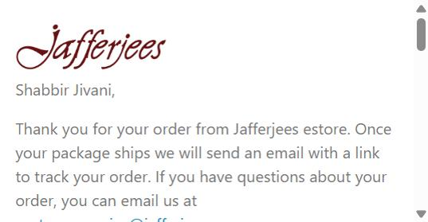
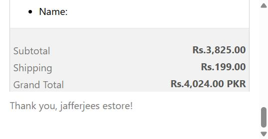

# Voice Findings — Order 20464 Confirmation Email

Source: `Order 20464 confirmed.eml` (Shopify transactional order-confirmation email)

## Finding 1 — Generic greeting and body, no brand voice

The email opens with the bare customer name ("Shabbir Jivani,") and unmodified Shopify boilerplate copy ("Thank you for your order from Jafferjees estore..."). There is no heritage language, no craftsmanship mention, no reference to the 1880 story or "fifth generation" — nothing that distinguishes this from any other Shopify store's default confirmation email.

## Finding 2 — Blank personalization field on a signature service

The ordered item (Las Vegas Wallet) has a "Name:" line item for engraving/personalization, left completely blank in the email. Personalization is one of Jafferjees' flagship complimentary services (per the FAQ), but this transactional moment does nothing to reinforce or confirm it — a missed opportunity to reassure the customer their engraving request was received correctly.

## Finding 3 — Generic, lowercase sign-off
(same screenshot as Finding 2, bottom line)

The email closes with "Thank you, jafferjees estore!" — lowercase brand name, generic Shopify-template phrasing, no signature, no name, no warmth. This is the exact gap Question 6 of the brand voice interview is meant to fix.

## Finding 4 — Generic subject line and sender name (from email headers, not visible in rendered body)
- Subject: "Order 20464 confirmed" — purely functional, no brand voice.
- Sender display name: "Jafferjees Store" — generic, not personal, doesn't match the family-heritage story the brand tells elsewhere (About Us: "fifth generation").

No screenshot for this one — it's visible in raw headers / an email client's header view, not in the rendered HTML body captured above.

## Summary
This transactional email is 100% unmodified Shopify default copy. It is the weakest point of Jafferjees' current written voice — none of the heritage, craftsmanship, or "pure natural leather" language found on the website carries through to the one email every customer is guaranteed to read.
